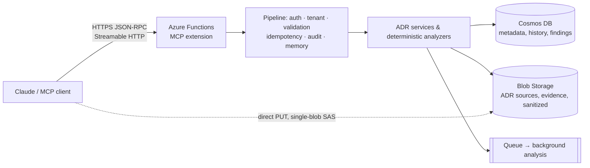

<div align="center">

# ADR Intelligence MCP Server

**Durable, evidence-backed architectural memory for Claude — hosted on Azure Functions.**

[](https://github.com/saulpatinojr/Proj-Cloud_Architect_Sidekick_MCP/actions/workflows/ci-cd.yml)
[](https://github.com/saulpatinojr/Proj-Cloud_Architect_Sidekick_MCP/actions/workflows/codeql.yml)
[](LICENSE)
[](https://dotnet.microsoft.com/)
[](https://learn.microsoft.com/azure/azure-functions/flex-consumption-plan)
[](https://modelcontextprotocol.io/)
[](infra/)
[](.github/SECURITY.md)
[](CODE_OF_CONDUCT.md)

</div>

---

## What is this?

An **enterprise-ready remote [Model Context Protocol](https://modelcontextprotocol.io/) server** that lets Claude (Claude Code, Claude.ai, Claude Desktop, or any MCP client) work with **Architectural Decision Records (ADRs)** as first-class, verifiable artifacts:

- **Record** decisions in MADR style with structured, testable claims; search, version, supersede and archive them.
- **Ingest evidence** (manifests, IaC, config, code) through a fast direct-to-Blob upload with quarantine, hashing and content-safety scanning.
- **Detect technologies** deterministically from `.csproj`, `package.json`, requirements, Dockerfiles, Bicep, Terraform, Kubernetes and CI files.
- **Detect drift** between accepted decisions and what the code and infrastructure actually do.
- **Detect contradictions** between decisions, with scope-aware false-positive guards.
- **Review safety** of proposed decisions (security, availability, data loss, privacy, compliance, lock-in, cost, EOL, operability, rollback, blast radius).
- **Remember** tool calls, decisions and human feedback per tenant and workspace with explainable retrieval.

And one guarantee above all: **the server never changes a human decision on its own.** Analyzers write only to system-managed observations; every suggested edit is a proposal a human approves.

## How it works



- **Transport**: Streamable HTTP at `https://<app>.azurewebsites.net/runtime/webhooks/mcp` (SSE fallback at `/sse`).
- **Auth**: Azure built-in Entra authentication (preview) for OAuth-based clients (`EntraBuiltIn`), or the `mcp_extension` system key header (`FunctionKey`). The code default is the key; the dev environment (`adr-dev`) is deployed in `EntraBuiltIn` mode (observed in the `ci-cd` run of 2026-10-26).
- **Identity**: user-assigned managed identity for every data-plane call; no connection strings, no account keys.
- **Hosting**: Azure Functions **Flex Consumption**, .NET 10 (LTS) isolated worker, MCP extension 1.6.0 (GA).

More detail: [Architecture](docs/01-architecture.md) · [Security & threat model](docs/04-security-threat-model.md) · [Decisions](docs/adr/).

## Quick start (local, no Azure subscription)

Prerequisites: .NET 10 SDK (10.0.1xx), Node.js 20+, Python 3.9+.

```bash
npm i -g azure-functions-core-tools@4 azurite
cp src/AdrMcp.Functions/local.settings.json.example src/AdrMcp.Functions/local.settings.json
mkdir -p .azurite && (azurite --silent --location .azurite --skipApiVersionCheck &)
dotnet build AdrMcp.sln
(cd src/AdrMcp.Functions && func start --port 7071)
```

Verify with the protocol smoke test (initialize, tools/list, read and write calls):

```bash
python3 scripts/smoke-test.py --url http://localhost:7071/runtime/webhooks/mcp --write
```

Connect Claude Code:

```bash
claude mcp add --transport http adr-local http://localhost:7071/runtime/webhooks/mcp
```

The example settings use in-memory persistence, so only Azurite is needed locally. The same code runs against Cosmos DB in Azure.

## Deploy to Azure

```bash
azd auth login
azd init -e adr-dev
azd env set AZURE_LOCATION eastus2        # one of the 16 regions in infra/region-codes.json
azd up                                    # Bicep provision + deploy
```

`azd up` creates: resource group, user-assigned identity, Storage (blob + queue, shared keys disabled), Cosmos DB serverless, Key Vault, Log Analytics + Application Insights, the Flex Consumption Function App, and least-privilege role assignments. Every name follows one convention, `<abbreviation>-<workload>-<environment>-<region code>-<nn>` (for `southcentralus`: `rg-adr-dev-scus-01`, `func-adr-dev-scus-01`, `kv-adr-dev-scus-01`, `stadrdevscus01`), see [ADR-0009](docs/adr/ADR-0009-azure-naming-convention.md). Optional flags: `ADR_AUTH_MODE=EntraBuiltIn`, `ADR_PRIVATE_NETWORKING=true`, `ADR_DEFENDER_STORAGE=true`, and `ADR_NAME_SUFFIX=<letters or digits>` only when a globally unique name is already taken.

Post-deploy check in `FunctionKey` mode (the key is read from Azure at run time and never stored in the repo). In `EntraBuiltIn` mode, which the dev environment uses, the key does not apply: the `ci-cd` deploy job checks that a call with no token gets HTTP 401 instead, and the tool smoke test needs a user's access token ([how](docs/06-claude-connection.md#smoke-test-against-an-entra-protected-server)):

```bash
RG=$(azd env get-value AZURE_RESOURCE_GROUP); APP=$(azd env get-value AZURE_FUNCTION_APP_NAME)
ADR_MCP_KEY="$(az functionapp keys list -g "$RG" -n "$APP" --query systemKeys.mcp_extension -o tsv)" \
  python3 scripts/smoke-test.py --url "$(azd env get-value MCP_ENDPOINT)"
```

Full walkthrough: [Local development & deployment](docs/05-local-dev-and-deploy.md).

## Connect Claude

The way to connect depends on the server's sign-in mode. The dev environment (`adr-dev`) runs in `EntraBuiltIn` mode, so a client signs in with Microsoft Entra ID. The shared `x-functions-key` header applies only to a server in `FunctionKey` mode, such as a local run. That each client below can sign in to `adr-dev` is **not yet verified**.

| Client | How (`EntraBuiltIn` mode, the dev environment) | How (`FunctionKey` mode only) |
|---|---|---|
| **Claude Code** | `claude mcp add --transport http adr https://<app>.azurewebsites.net/runtime/webhooks/mcp --client-id <public-client-app-id> --callback-port 8976`, then `/mcp` to sign in ([steps](docs/06-claude-connection.md#claude-code-cli)) | `claude mcp add --transport http adr https://<app>.azurewebsites.net/runtime/webhooks/mcp --header "x-functions-key: ${ADR_MCP_KEY}"` or the committed `.mcp.json`, which sends only the key header (reads `ADR_MCP_URL` / `ADR_MCP_KEY` from your environment) |
| **Claude.ai / Desktop / Cowork / mobile** | *Customize → Connectors → Add custom connector* with the MCP URL; choose **custom OAuth client** for Entra. Claude connects from Anthropic's cloud, so the endpoint must be reachable from the internet. | same steps, but choose **request headers** (`x-functions-key`) |
| **VS Code / Copilot** | sign in with Entra using Microsoft's built-in VS Code client app, which must be on the allow-list ([Entra sign-in](docs/11-entra-sign-in.md)) | `.vscode/mcp.json` (prompts for host and key) |
| **Anything else** | Any MCP client that speaks Streamable HTTP and supports OAuth with a pre-registered client | Any MCP client that speaks Streamable HTTP and can send a header |

Details, OAuth notes and upload guidance: [Connecting Claude](docs/06-claude-connection.md). The dev environment signs in with Microsoft Entra ID instead of a shared key; settings, what is verified and what is not, and a real-tenant runbook: [Entra sign-in](docs/11-entra-sign-in.md).

## Tools

| Group | Tools |
|---|---|
| ADR management | `adr_create` `adr_get` `adr_list` `adr_search` `adr_update` `adr_propose_change` `adr_approve_change` `adr_reject_change` `adr_supersede` `adr_archive` `adr_history` `adr_export` `adr_import` |
| Evidence | `file_upload_request` `file_register_upload` `evidence_attach` `evidence_list` `evidence_remove` |
| Analysis | `technology_detect` `technology_refresh` `adr_detect_drift` `adr_check_contradictions` `adr_safety_review` `finding_review` |
| Jobs & memory | `analysis_job_get` `analysis_job_cancel` `analysis_job_results` `decision_memory_search` |
| Specified for later phases | `file_import_from_repository` `adr_find_related_code` `adr_impact_analysis` `architecture_fitness_check` `dependency_map_generate` `c4_model_generate` `decision_lineage_get` `architecture_rule_create` `architecture_rule_validate` `governance_check` `deployment_readiness_check` |

Bringing in decisions you already have (a wiki or a folder of Markdown files)? See [Importing existing ADRs](docs/10-legacy-adr-import.md): a read-only `scan` with a data-quality report, then `adr_import`.

Every tool advertises an exact JSON Schema and returns a compact envelope `{ ok, data, error, meta }`. Full contracts with examples are generated from code: [MCP tool contracts](docs/03-mcp-contracts.md).

### Typical flow

1. `adr_create` a decision with claims (e.g. *"must not use Newtonsoft.Json"*).
2. `file_upload_request` → `PUT` the manifest to the returned URL → `file_register_upload`.
3. `adr_detect_drift` → each claim is **Compliant / Drifted / Uncertain / Unsupported / NotApplicable** with evidence and confidence.
4. `adr_check_contradictions` → findings with `needsSemanticReview` when deterministic confidence is low.
5. A human records the outcome with `finding_review`; any text change goes through `adr_propose_change` → `adr_approve_change`.

## Configuration

All settings are plain app settings (`Section__Key`). Placeholders only; secrets come from Key Vault references or your local, git-ignored `local.settings.json`.

| Setting | Default | Purpose |
|---|---|---|
| `Persistence__Provider` | `Cosmos` | `Cosmos` or `InMemory` (local/testing) |
| `Cosmos__AccountEndpoint` | — | `https://<account>.documents.azure.com:443/` (managed identity) |
| `Storage__BlobServiceUri` / `Storage__QueueServiceUri` | — | Storage endpoints (managed identity); `Storage__ConnectionString=UseDevelopmentStorage=true` for Azurite |
| `Auth__Mode` | `FunctionKey` | `FunctionKey` (system key at the edge, static tenant binding) or `EntraBuiltIn` (App Service auth, roles from Entra app roles) |
| `Auth__StaticRoles__n` | none → Reader | Roles for the key-based principal (`Reader`, `Author`, `Approver`, `Admin`) |
| `Auth__Entra__ValidateBearerToken` and `Auth__Entra__*` | `false` | Entra mode, optional second layer: the app verifies the bearer token itself (tenant, client IDs, scope, key cache). Off by default; see [Entra sign-in](docs/11-entra-sign-in.md) |
| `Auth__DefaultRoleWhenNoAppRoles` | `None` | Entra mode: role for a caller with no mapped app role (`None` refuses it; `Reader` lets any tenant user read) |
| `Auth__Tenants__n__Id` / `__MapTo` / `__Workspaces__n` | none | Entra mode: enrolled tenant (tid GUID), optional ADR tenant ID to store it under, and its workspaces (`default` when empty). Once any tenant is enrolled, other tenants are refused; each tenant needs its own ADR tenant ID. Bicep enrolls the deployment tenant |
| `Auth__TenantWorkspaces__<tenant>__n` | `default` | Workspaces a tenant may use, keyed by ADR tenant ID. Linux app setting names allow only letters, digits and `_`, so use `Auth__Tenants` for a GUID tenant |
| `Adr__PrincipalHashSalt` | Key Vault reference | Salt for hashed principals in audit/memory |
| `Uploads__MaxFileBytes` | `52428800` | Upload size cap (50 MiB) |
| `Uploads__UploadUrlTtlMinutes` | `15` | Lifetime of the single-blob upload grant |
| `Uploads__BlockOnCriticalSafetyFinding` | `true` | Reject uploads containing critical secrets |
| `Uploads__RequireDefenderScanResult` | `false` | Require Microsoft Defender for Storage verdict before approval |
| `SafetyPolicy__BlockingRuleIds__n` | none | Safety-review rules that hard-block acceptance (organization policy) |
| `ContentSafety__*` | see options | Custom patterns, allow-list fingerprints, disabled detectors |

Complete list: `src/AdrMcp.Application/Options/AdrOptions.cs`, `src/AdrMcp.Infrastructure/Options/InfrastructureOptions.cs`, `src/AdrMcp.Analysis/Safety/CompositeContentSafetyService.cs`.

## Security model in one minute

- Authentication at the edge (system key or Entra built-in auth); authorization per tool by role (Reader ⊂ Author ⊂ Approver ⊂ Admin).
- Tenant and workspace are resolved from the authenticated principal, **never** from tool arguments; all data is partitioned by `tenant|workspace`.
- Managed identity only; shared-key access and Cosmos local auth are disabled; Key Vault holds the only secret material.
- Uploads: allow-listed types, size caps, quarantine, server-side SHA-256, MIME sniffing, deterministic secret/PII masking, prompt-injection neutralization; analyzers read **sanitized** content only.
- Human-owned fields have a single write path requiring human provenance; every revision is snapshotted with a content hash.
- Logs, errors and audit records pass through a redactor; principals are stored hashed.

Full details and the STRIDE table: [Security & threat model](docs/04-security-threat-model.md). Report vulnerabilities privately per [SECURITY.md](.github/SECURITY.md).

## Working with AI agents in this repo

- **Claude Code**: `CLAUDE.md` holds project rules; `.claude/agents/` ships a tailored agent pack (ADR author, drift investigator, contradiction reviewer, security reviewer, Bicep reviewer, MCP contract guardian, test engineer, release engineer, docs keeper, multi-cloud architect). See [`.claude/agents/README.md`](.claude/agents/README.md).
- **GitHub Copilot**: equivalents in `.github/agents/*.agent.md` and `.github/copilot-instructions.md`.
- **Cloud provider MCP servers** (Azure, AWS, Google Cloud, Terraform, GitHub) are pre-wired read-only in `.mcp.json`, `.vscode/mcp.json` and documented in [`.github/mcp/README.md`](.github/mcp/README.md). They use your own CLI identity; no credentials are stored.

## Documentation index

| | Document |
|---|---|
| A | [Source assessment & assumptions](docs/00-source-assessment.md) |
| B | [Architecture](docs/01-architecture.md) |
| C | [Architecture decision records](docs/adr/) |
| D | [Repository structure](docs/02-repository-structure.md) |
| F | [MCP tool contracts](docs/03-mcp-contracts.md) |
| — | [Security & threat model](docs/04-security-threat-model.md) |
| H | [Local development & deployment](docs/05-local-dev-and-deploy.md) |
| I | [Connecting Claude](docs/06-claude-connection.md) |
| J/K | [Tests & CI/CD](docs/07-tests-and-ci.md) |
| L | [Roadmap](docs/08-roadmap.md) |
| — | [Fitness functions, memory, async jobs](docs/09-fitness-functions-and-memory.md) |
| — | [Importing existing ADRs](docs/10-legacy-adr-import.md) |
| — | [Entra sign-in](docs/11-entra-sign-in.md) |

## Project status

Verified in this repository: clean Release build, all unit tests and 6 of 7 integration tests passing (the Cosmos DB test is skipped unless `ADR_TEST_COSMOS_ENDPOINT` or `ADR_TEST_COSMOS_CONNECTION_STRING` is set), Bicep builds without warnings, and an end-to-end MCP smoke test against the real local Functions host. Items marked **[VERIFY]** in the docs (preview features, external redirect URIs, API versions) and **[REVIEW REQUIRED]** (identity setup) should be checked by a human before production use.

## Contributing & community

[Contributing guide](CONTRIBUTING.md) · [Code of conduct](CODE_OF_CONDUCT.md) · [Support](SUPPORT.md) · [Changelog](CHANGELOG.md) · [Security policy](.github/SECURITY.md)

## Acknowledgements

Concepts were informed by the MIT-licensed [mcp-adr-analysis-server](https://github.com/tosin2013/mcp-adr-analysis-server); no code was copied (see [THIRD-PARTY-NOTICES.md](THIRD-PARTY-NOTICES.md)). Built on the [Azure Functions MCP extension](https://learn.microsoft.com/azure/azure-functions/functions-bindings-mcp).

## License

[MIT](LICENSE)
