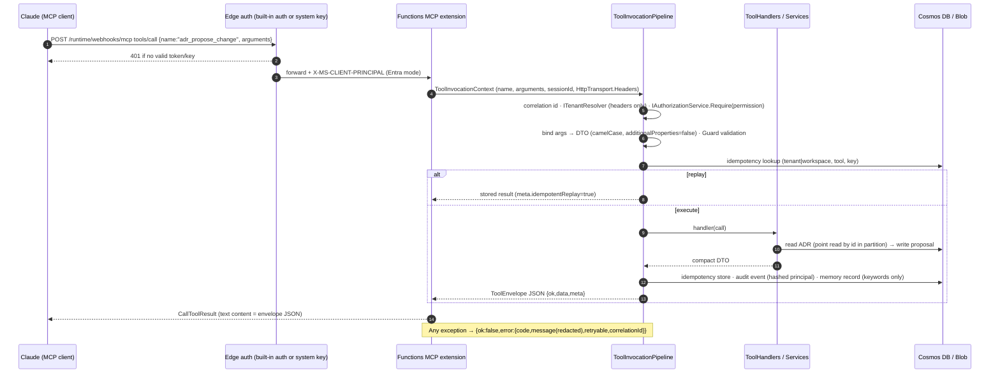

# B. Architecture

## B.1 Component diagram

```mermaid
flowchart LR
  subgraph Clients["MCP clients (untrusted network)"]
    CD[Claude.ai / Claude Desktop<br/>custom connector]
    CC[Claude Code<br/>claude mcp add --transport http]
  end

  subgraph Edge["Azure Functions front door"]
    AUTH[App Service Authentication<br/>Entra ID + PRM (preview)<br/>or mcp_extension system key]
  end

  subgraph FA["Function App (Flex Consumption, .NET 8 isolated, user-assigned MI)"]
    MCP[MCP extension<br/>/runtime/webhooks/mcp<br/>Streamable HTTP]
    PIPE[ToolInvocationPipeline<br/>correlation · tenant resolution · authz<br/>binding/validation · idempotency · audit · memory]
    SVC[Application services<br/>AdrService · ChangeProposalService · FileUploadService<br/>TechnologyService · DriftService · ContradictionService · SafetyReviewService]
    AN[Analysis plugins<br/>ContentSafety · ITechnologyDetector[] · IDriftDetector[]<br/>IContradictionRule[] · ISafetyReviewRule[]]
    QW[AnalysisJobWorker<br/>QueueTrigger]
    TM[MaintenanceTimer]
  end

  subgraph Data["Azure data plane (private endpoints optional)"]
    COS[(Cosmos DB NoSQL · serverless<br/>adrs · adr-history · proposals · evidence<br/>findings · jobs · memory · audit · idempotency)]
    BLOB[(Blob Storage<br/>adr-source · uploads-quarantine<br/>evidence (immutable) · evidence-sanitized<br/>reports · snapshots · manifests · diagrams)]
    Q[[Storage Queue<br/>analysis-jobs / -poison]]
    KV[(Key Vault<br/>principal-hash salt · org patterns)]
    AI[(Application Insights<br/>Log Analytics)]
  end

  CD -->|HTTPS JSON-RPC| AUTH
  CC -->|HTTPS JSON-RPC| AUTH
  AUTH --> MCP --> PIPE --> SVC --> AN
  SVC --> COS
  SVC --> BLOB
  SVC -->|enqueue job| Q --> QW --> SVC
  TM --> SVC
  FA -.->|MI, Key Vault reference| KV
  FA -.-> AI
  CD -. direct PUT with single-blob SAS .-> BLOB
  CC -. direct PUT with single-blob SAS .-> BLOB
```

## B.2 Sequence: Claude calls an MCP tool



## B.3 Sequence: direct file upload

```mermaid
sequenceDiagram
  autonumber
  participant C as Claude / user agent
  participant S as ADR MCP server
  participant B as Blob (uploads-quarantine)
  participant Q as Queue
  C->>S: file_upload_request {fileName, mediaType, expectedSizeBytes, sha256?, adrId?}
  S->>S: sanitize name · extension/MIME/size allow-lists · duplicate check by sha256
  S->>B: GetUserDelegationKey (MI) → SAS: one blob, Create+Write only, 15 min, HTTPS
  S-->>C: {uploadId, uploadUrl, method:PUT, headers, expiresAt}
  C->>B: PUT bytes (x-ms-blob-type: BlockBlob) — bypasses MCP entirely
  C->>S: file_register_upload {uploadId, sha256?}
  S->>B: GetProperties (exists, length, Defender tag?) · stream → SHA-256 (byte cap) · sniff first 512 bytes
  S->>S: duplicate by content hash → link existing evidence
  S->>S: ContentSafetyService: secrets/PII/custom/prompt-injection → mask/flag/block
  alt critical finding and policy blocks
    S->>B: delete quarantine blob
    S-->>C: CONTENT_SAFETY_BLOCKED (no secret values in response)
  else approved
    S->>B: write sanitized variant · server-side copy to evidence (immutable) · delete quarantine
    S->>S: attach to ADR (observed state, human provenance)
    S->>Q: enqueue EvidenceProcessing job (dedupe key evidence:{id})
    S-->>C: {evidenceId, state:approved, safety summary, jobId}
  end
  Note over B: SAS cannot list/read; lifecycle policy purges quarantine after 1 day; register is single-use (replay returns recorded outcome)
```

## B.4 Sequence: automatic technology refresh and drift detection

```mermaid
sequenceDiagram
  autonumber
  participant T as MaintenanceTimer / Claude (technology_refresh async)
  participant J as AnalysisJobService
  participant Q as Queue
  participant W as AnalysisJobWorker
  participant TS as TechnologyService
  participant DS as DriftService
  participant D as Cosmos DB
  participant B as Blob (evidence-sanitized)
  T->>J: EnqueueAsync(TechnologyRefresh, adrId, dedupeKey)
  J->>D: jobs: create (Queued) — returns existing active job on dedupe
  J->>Q: message {jobId, tenantId, workspaceId, correlationId}
  Q->>W: deliver (at-least-once)
  W->>J: ProcessAsync → Running (attempt n)
  J->>TS: RefreshAsync(tenant, ws, adrId)
  TS->>B: load sanitized evidence (caps: files, bytes)
  TS->>TS: ITechnologyDetector[] → merge: keep firstObservedAt, mark vanished Removed
  TS->>D: ApplyObservedUpdate (snapshot before/after, ETag retry) — human content hash unchanged
  J->>DS: ScanAsync(adrId)
  DS->>DS: claims = declared ∪ extracted(inferred) → IDriftDetector[] → per-claim result + evidence
  DS->>D: findings: upsert with previous result (status change flagged) · ADR driftStatus
  J->>D: jobs: Succeeded + compact result (or Failed/Poisoned after maxDequeueCount)
  Note over DS,D: Decision text is never modified; a human reviews Drifted findings via finding_review
```

## B.5 Trust boundaries

| Boundary | Inside | Outside | Controls |
|---|---|---|---|
| **TB1 Internet → Edge** | Function App | Claude clients, attackers | TLS 1.2+, built-in Entra auth (preview) or `mcp_extension` system key, Functions platform rate limiting, Flex Consumption scale caps, optional IP restrictions / Anthropic egress allow-list. |
| **TB2 Edge → Worker** | Pipeline, services | Tool arguments, headers | Arguments are untrusted JSON: strict DTO binding, `additionalProperties:false`, length/pattern limits, 2 MB argument cap. Tenant/workspace resolved from principal only. |
| **TB3 Worker → Data** | Cosmos, Blob, Queue, Key Vault | — | User-assigned managed identity, least-privilege RBAC, shared-key access disabled, Cosmos local auth disabled, Key Vault RBAC, optional private endpoints. |
| **TB4 Evidence content** | Analyzers | Uploaded files | Quarantine container, size/MIME/extension checks, hash verification, deterministic content safety, sanitized-only reads, no execution, prompt-injection neutralization, excerpts truncated. |
| **TB5 Human-owned decision** | `HumanOwnedContent` | Analyzers, agents, Claude | Separate record type with a single human-provenance write path; proposals require explicit approval; content hash recorded per revision. |

## B.6 Data flow summary

1. **Human-owned content** flows Claude → `adr_create`/`adr_propose_change` → (approval) → Cosmos `adrs` + Markdown source in Blob `adr-source` + snapshot in `adr-history`.
2. **Evidence** flows client → Blob quarantine → (verify, scan) → Blob `evidence` (original, immutable, access-controlled) + Blob `evidence-sanitized` (what analyzers see) + Cosmos `evidence` metadata.
3. **Observations** flow sanitized evidence → detectors → Cosmos `adrs.observed` (+ snapshot) and `findings`.
4. **Telemetry** flows through `SensitiveDataRedactor` before reaching Application Insights; audit and memory records contain hashed principals and keywords only.

## B.7 Failure paths

| Failure | Behaviour |
|---|---|
| Cosmos 429 | SDK retries (5 × up to 10 s); then `RATE_LIMITED` retryable error. |
| ETag conflict on human change | `ETAG_MISMATCH` (retryable) — client reloads and retries. Observed updates retry internally (3×) because they are merges. |
| Concurrent `adr_create` producing the same number | Second create fails with `CONFLICT` on the id; client retries (number recomputed). |
| Upload grant expires before PUT | `file_register_upload` → `UPLOAD_EXPIRED`; record marked Expired; lifecycle policy purges the blob. |
| PUT done, register never called | Timer + lifecycle purge quarantine after 24 h; record Expired. |
| Job handler throws | Message re-queued up to `maxDequeueCount` (3); job record updated each attempt; after the last attempt job = `Poisoned`, message → `analysis-jobs-poison`. |
| Job cancelled mid-run | Cancellation flag is checked at each progress report; job = `Cancelled`. |
| Analyzer plugin throws | Detector error is captured as an `Uncertain` result with a redacted message; other detectors continue. |
| Key Vault reference unresolved | App setting is empty → `Adr:PrincipalHashSalt` falls back to a non-secret default and logs a warning at start **[production must fail fast: see roadmap hardening]**. |
| Audit/memory write fails | Logged as error; the tool result is still returned (availability over audit completeness for MVP; hardening phase makes audit mandatory). |
